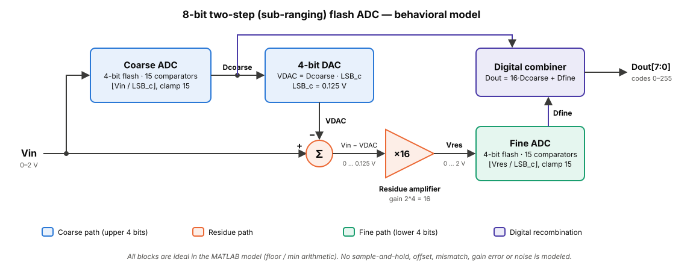
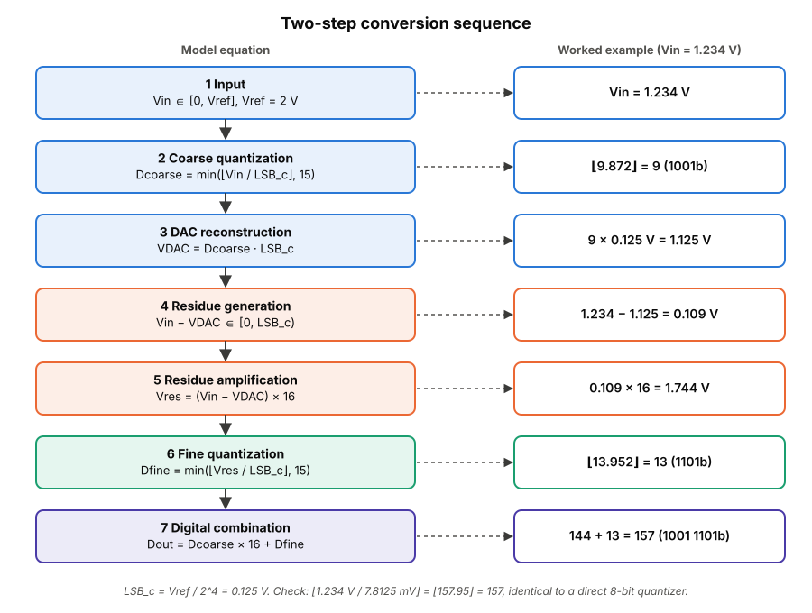
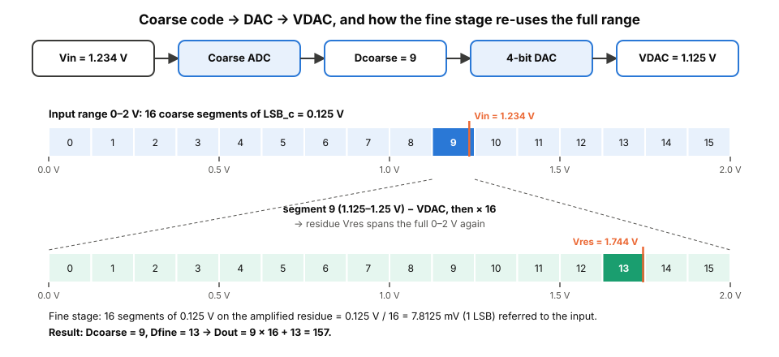
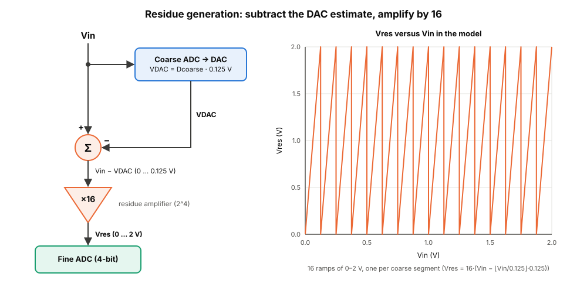
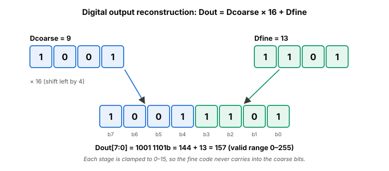
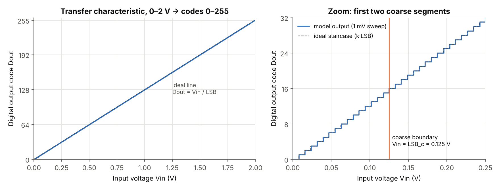
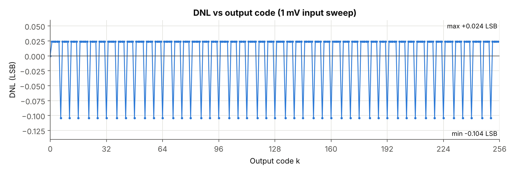
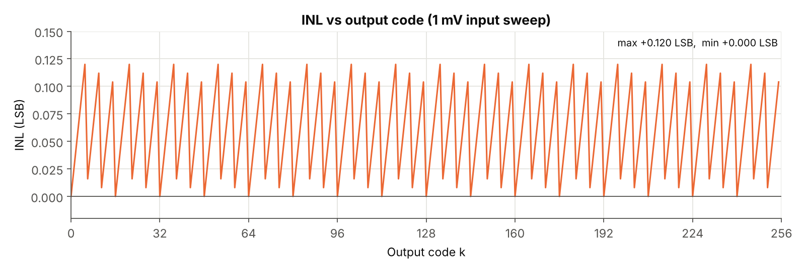
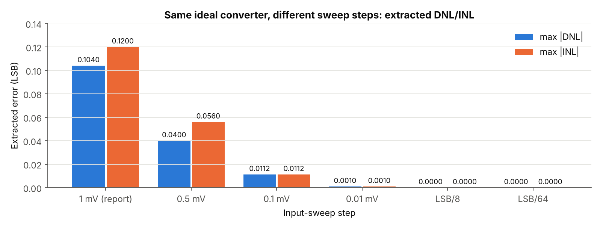
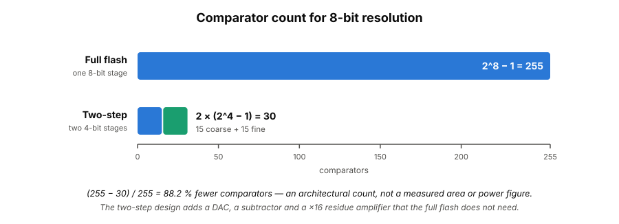

# 8-Bit Two-Step Flash ADC

**Behavioral MATLAB model with coarse/fine quantization, residue generation, comparator-count analysis, and DNL/INL evaluation**

This project models an 8-bit **two-step (sub-ranging) flash ADC**. Two 4-bit flash stages replace one 8-bit flash. A coarse stage resolves the upper 4 bits, and a DAC turns that code back into a voltage. The difference from the input is amplified ×16 and resolved by a fine stage for the lower 4 bits. The model sweeps the full 0–2 V input range. It extracts the transfer characteristic, checks for missing codes and computes DNL/INL from the code transitions.

> **Scope:** this is an architecture-level **behavioral model** (ideal arithmetic in MATLAB, also run in GNU Octave). It is not a transistor-level design, a fabricated chip or a hardware measurement. Every number below says where it comes from. See [Evidence and audit](docs/evidence-and-audit.md).

| Parameter | Value | Source |
|---|---:|---|
| Resolution | 8-bit | model `N = 8` |
| Input range | 0–2 V | model `Vin = 0:0.001:Vref` |
| Reference | 2 V | model `Vref = 2` |
| Coarse stage | 4-bit | model `N_stage = 4` |
| Fine stage | 4-bit | model `N_stage = 4` |
| Output levels | 256 (codes 0–255) | model run: 256 of 256 codes present |
| LSB | 7.8125 mV | calculated `Vref / 2^8` |
| Residue gain | ×16 | model `(Vin − V_dac) · 2^N_stage` |
| Flash comparator count | 255 | `2^8 − 1` (report + calculation) |
| Two-step comparator count | 30 | `2 × (2^4 − 1)` (report + calculation) |
| DNL (1 mV sweep) | −0.104 … +0.024 LSB | model run, matches report (−0.10 / +0.02) |
| INL (1 mV sweep) | 0 … +0.120 LSB | model run, matches report (≈0 / +0.12) |
| Missing codes | none | model run |

> **Key finding from re-running the model.** The model is ideal: it has no mismatch, offset or gain error. Its true DNL and INL are **zero**, and the nonzero values above come from the **1 mV input-sweep step**. That step is not a divisor of the 7.8125 mV LSB, so the 1 mV grid can only place each code transition to the nearest millivolt above it. With an LSB-aligned sweep the same code returns exactly 0.000 LSB ([sweep-step study](#what-the-dnlinl-numbers-actually-measure)). The project report attributes the periodic DNL/INL pattern to capacitor mismatch, comparator imbalance and residue gain error. None of those is in the model, so that explanation is not supported.

---

## Contents

[Architecture](#adc-architecture) · [Why two-step?](#why-a-two-step-adc) · [How it works](#how-the-two-step-adc-works) · [Coarse](#coarse-quantization) · [DAC](#dac-reconstruction) · [Residue](#residue-generation) · [Fine](#fine-quantization) · [Output code](#digital-output-reconstruction) · [LSB](#resolution-and-lsb) · [MATLAB model](#matlab-behavioral-model) · [Transfer](#transfer-characteristic) · [DNL](#differential-non-linearity-dnl) · [INL](#integral-non-linearity-inl) · [Missing codes](#missing-code-analysis) · [Comparators](#comparator-count-comparison) · [Error sources](#potential-error-sources) · [Tradeoffs](#design-tradeoffs) · [Results](#results) · [Reproduction](#reproduction) · [Limitations](#limitations) · [Future work](#future-work)

---

## ADC Architecture



| Path | Blocks | What it does in the model |
|---|---|---|
| **Coarse path** | 4-bit coarse ADC → 4-bit DAC | `D_coarse = min(floor(Vin/LSB_c), 15)`, `V_dac = D_coarse·LSB_c` |
| **Residue path** | subtractor → ×16 amplifier | `V_residue = (Vin − V_dac)·16` |
| **Fine path** | 4-bit fine ADC | `D_fine = min(floor(V_residue/LSB_c), 15)` |
| **Digital recombination** | combiner | `D_out = D_coarse·16 + D_fine` |

Every block is ideal arithmetic. The "4-bit flash ADC" blocks are `floor()` operations, the mathematical equivalent of an ideal 15-comparator thermometer quantizer. No comparators are instantiated individually. The model has no sample-and-hold, because the input is a static sweep. Full description: [docs/architecture.md](docs/architecture.md).

## Why a Two-Step ADC?

A full flash ADC needs one comparator per code transition:

```
8-bit flash      : 2^8 − 1           = 255 comparators
8-bit two-step   : 2 × (2^4 − 1)     =  30 comparators  (15 coarse + 15 fine)
```

The two-step converter gets the same 8-bit code from two small flash stages. It pays for that with extra analog blocks between them:

| | Gains | Costs |
|---|---|---|
| Two-step vs. full flash | 225 fewer comparators (88.2 % fewer by count) | needs a DAC, a subtractor and an accurate ×16 residue amplifier |
| | smaller comparator array → **potential** area/power savings | two quantization steps in series → more latency than a single flash |
| | lower reference-ladder resolution per stage | new error sources: DAC accuracy, residue gain, coarse/fine alignment |

A lower comparator count is an architectural fact. Lower power or area would be an implementation result, and this project does not measure either.

## How the Two-Step ADC Works



1. **Input:** `Vin` in 0–2 V. The model sweeps it as a static ramp.
2. **Coarse quantization:** the coarse ADC finds the upper 4 bits, `D_coarse`.
3. **DAC reconstruction:** `D_coarse` is converted back to a voltage, `V_dac`.
4. **Subtraction:** `Vin − V_dac` is what the coarse stage could not resolve (0 to 0.125 V).
5. **Residue amplification:** that difference is multiplied by 16, so it spans 0–2 V again.
6. **Fine quantization:** the fine ADC finds the lower 4 bits, `D_fine`.
7. **Combination:** `D_out = D_coarse × 16 + D_fine`.

The worked example in the figure (Vin = 1.234 V → 157) matches a direct 8-bit quantizer: ⌊1.234 / 0.0078125⌋ = 157. Step-by-step math: [docs/two-step-operation.md](docs/two-step-operation.md).

## Coarse Quantization

```matlab
LSB_c    = Vref / (2^N_stage);           % 2 V / 16 = 0.125 V  (derived)
D_coarse = floor(Vin(i) / LSB_c);
D_coarse = min(D_coarse, 2^N_stage - 1); % clamp to 15
```

The coarse stage divides 0–2 V into **16 regions of 0.125 V** and reports which region holds `Vin`. That region number is the upper nibble of the output. The clamp is needed only at `Vin = Vref = 2 V`, where `floor(2/0.125) = 16` would overflow 4 bits. The model does not clip negative inputs because the sweep never goes below 0 V.

## DAC Reconstruction



```matlab
V_dac = D_coarse * LSB_c;   % lower edge of the selected coarse region
```

The DAC returns the **lower edge** of the coarse region, so `Vin − V_dac` always lies in `[0, LSB_c)`. The only exception is the clamped endpoint `Vin = 2 V`, where it equals `LSB_c`. The DAC is ideal: its output levels are exact multiples of 0.125 V.

## Residue Generation



```matlab
V_residue = (Vin(i) - V_dac) * (2^N_stage);   % × 16
```

The coarse stage has already used up most of the input range, so only a 0–125 mV remainder is left. Amplifying it by `2^N_stage = 16` stretches it back to the full 0–2 V range. The fine stage can then reuse the **same 0.125 V step size** as the coarse stage. Without the gain, the fine stage would need 7.8125 mV comparator spacing. Plotted against `Vin`, the residue is a sawtooth with one 0–2 V ramp per coarse region (right side of the figure).

## Fine Quantization

```matlab
D_fine = floor(V_residue / LSB_c);       % fine LSB equals LSB_c = 0.125 V
D_fine = min(D_fine, 2^N_stage - 1);     % clamp to 15
```

The report writes this as `D_fine = ⌊V_res / LSB_fine⌋`. The code uses `LSB_c` for the fine stage, and the two are the same because the ×16 residue spans the full reference. Referred back to the input, one fine step is `0.125 V / 16 = 7.8125 mV = 1 LSB`. The clamp again only matters at `Vin = 2 V` (residue = 2 V).

## Digital Output Reconstruction



```matlab
D_out(i) = (D_coarse * 2^N_stage) + D_fine;   % = (D_coarse << 4) | D_fine
```

`D_coarse` supplies bits [7:4] and `D_fine` supplies bits [3:0]. Both stages are clamped to 0–15, so the sum never carries and the multiply-add is the same as a 4-bit shift plus concatenation. The output range is 0–255. This simple combination works only because the model is ideal. A real two-step ADC usually adds stage overlap (redundancy) and digital correction (see [Future work](#future-work)).

## Resolution and LSB

```
Levels            2^N        = 2^8           = 256
LSB  (8-bit)      Vref / 2^N = 2 V / 256     = 7.8125 mV
LSB_c (stage)     Vref / 2^4 = 2 V / 16      = 0.125 V   (coarse step = fine step on the ×16 residue)
Residue gain      2^4                         = 16
Fine step referred to input   0.125 V / 16   = 7.8125 mV  (= 1 LSB)
```

These are three different quantities. **LSB** is the 8-bit converter's resolution. **LSB_c** is the step size inside each 4-bit stage. **×16** is the residue scale factor that connects them.

## MATLAB Behavioral Model

The model is a single script, [`matlab/two_step_adc_model.m`](matlab/two_step_adc_model.m), transcribed unchanged from the project report. It runs in MATLAB and GNU Octave with no toolboxes.

| Section | Variables | Purpose |
|---|---|---|
| Parameters | `N = 8`, `N_stage = 4`, `Vref = 2`, `LSB` | resolution and reference |
| Input sweep | `Vin = 0:0.001:Vref` | 2001-point static ramp, 1 mV step |
| Conversion loop | `D_coarse`, `V_dac`, `V_residue`, `D_fine`, `D_out` | the two-step algorithm per sample |
| Transitions | `code_transitions(k+1) = Vin(find(D_out >= k, 1))` | first input that reaches each code |
| Linearity | `DNL = [0, diff(T)/LSB − 1]`, `INL = cumsum(DNL)` | DNL/INL in LSB |
| Plots | transfer curve; DNL+INL vs. code | |

Supporting scripts added in this repository:

| File | Role |
|---|---|
| [`matlab/run_linearity_analysis.m`](matlab/run_linearity_analysis.m) | runs the model unchanged, prints the metrics, checks missing codes and monotonicity, exports CSVs to [`results/`](results) |
| [`matlab/sweep_step_study.m`](matlab/sweep_step_study.m) | repeats the DNL/INL extraction for six sweep steps |
| [`matlab/two_step_adc_convert.m`](matlab/two_step_adc_convert.m), [`matlab/transition_linearity.m`](matlab/transition_linearity.m) | the model's loop body and transition/DNL/INL code as functions (used by the sweep study) |
| [`python/make_figures.py`](python/make_figures.py) | renders the PNGs from the exported CSVs, after checking a NumPy port of the converter against all 2001 exported codes |

Line-by-line explanation: [docs/code-walkthrough.md](docs/code-walkthrough.md). Equations: [docs/mathematical-model.md](docs/mathematical-model.md).

## Transfer Characteristic



- **x-axis:** input voltage `Vin` (V), 0–2 V. **y-axis:** output code `D_out`, 0–255.
- The curve is a uniform staircase of 256 codes that follows the ideal line `Vin / LSB`. The right panel zooms in on the first two coarse regions. The coarse/fine boundary at 0.125 V (code 15 → 16) causes no extra step error.
- The model is ideal, but the curve is still a staircase. Each code is 1 LSB wide, so the quantization error is between 0 and +1 LSB (this quantizer uses `floor`, not round-to-nearest).

The figure is plotted from [`results/transfer/transfer_characteristic.csv`](results/transfer/transfer_characteristic.csv), which `run_linearity_analysis.m` exports. The original MATLAB figure from the report is kept as [`assets/report-original-matlab-output.png`](assets/report-original-matlab-output.png). It shows the same curves.

## Differential Non-Linearity (DNL)

DNL is how far each code step is from the ideal 1 LSB. The model computes it from the swept code transitions `T_k`:

```matlab
actual_steps = diff(code_transitions);   % T_k − T_(k−1)
DNL = (actual_steps - LSB) / LSB;        % (step − 1 LSB) / 1 LSB
DNL = [0, DNL];                          % code 0 assigned 0
```



| DNL (1 mV sweep) | Model run | Report |
|---|---:|---:|
| Minimum | −0.104 LSB (47 codes) | ≈ −0.10 LSB |
| Maximum | +0.024 LSB (208 codes) | ≈ +0.02 LSB |
| max \|DNL\| | 0.104 LSB | ≈ 0.10 LSB |

Only two values occur. On the 1 mV grid each code step measures either **8 mV** (`(8 − 7.8125)/7.8125 = +0.024`) or **7 mV** (`(7 − 7.8125)/7.8125 = −0.104`).

## Integral Non-Linearity (INL)

```matlab
INL = cumsum(DNL);   % = (T_k − k·LSB) / LSB, since T_0 = 0
```

INL is the running total of DNL. Because `T_0 = 0 V`, it equals each transition's offset from its ideal position `k·LSB`. There is no endpoint or best-fit correction.



| INL (1 mV sweep) | Model run | Report |
|---|---:|---:|
| Minimum | 0.000 LSB (codes 0, 16, 32, …) | ≈ 0 LSB ("slightly negative, very small") |
| Maximum | +0.120 LSB (codes 5, 21, 37, …) | ≈ +0.12 LSB |
| max \|INL\| | 0.120 LSB | ≈ 0.12 LSB |

INL is not zero in this run. It is a sawtooth with three teeth every 16 codes (a 125 mV period), and it never accumulates past 0.120 LSB.

### What the DNL/INL numbers actually measure



Each transition `T_k` is the first 1 mV grid point at or above the ideal edge `k × 7.8125 mV`. The measured INL is therefore `(ceil_1mV(k·LSB) − k·LSB) / LSB`, and the pattern repeats every 16 codes because `16 × 7.8125 mV = 125 mV` lands exactly on the grid. [`matlab/sweep_step_study.m`](matlab/sweep_step_study.m) runs the same converter and extraction with other sweep steps:

| Sweep step | Points | DNL min / max (LSB) | INL max (LSB) |
|---|---:|---:|---:|
| 1 mV (report) | 2 001 | −0.104 / +0.024 | 0.120 |
| 0.5 mV | 4 001 | −0.040 / +0.024 | 0.056 |
| 0.1 mV | 20 001 | −0.0016 / +0.0112 | 0.0112 |
| 0.01 mV | 200 001 | −0.00032 / +0.00096 | 0.00096 |
| LSB/8 = 0.9765625 mV | 2 049 | 0 / 0 | 0 |
| LSB/64 | 16 385 | 0 / 0 | 0 |

The extracted error shrinks with the sweep step and is exactly zero for any LSB-aligned grid. The reported DNL/INL therefore bound the **measurement resolution of the testbench**, not converter nonlinearity. The periodic pattern lines up with the 16-code coarse boundaries only because 125 mV is both the coarse step and the grid's repeat period. It is not evidence of mismatch. Full analysis: [docs/linearity.md](docs/linearity.md).

## Missing-Code Analysis

A code is missing if no input voltage produces it, which is the same as that code having zero width (DNL = −1 LSB). The model run checks this directly:

- **All 256 codes (0–255) appear** in `D_out` over the sweep, so **no codes are missing**. This holds for all six sweep steps in the study.
- `D_out` never decreases as `Vin` rises, so the output is **monotonic on the swept grid**.
- Worst-case DNL is −0.104 LSB, far from −1 LSB, which agrees with the direct check.

The report says there are no missing codes "since the difference in steps is less than 1 unit". The condition that actually rules out a missing code is DNL > −1 LSB. Monotonicity here was verified directly on the sweep, not inferred from DNL.

## Comparator Count Comparison



| Architecture | Resolution | Comparator count |
|---|---:|---:|
| Full flash | 8-bit | 2^8 − 1 = **255** |
| Two-step (4 + 4) | 8-bit | 2 × (2^4 − 1) = **30** |

Calculated architectural comparison: `(255 − 30) / 255 × 100 = 88.2 %` fewer comparators. This is a component count only. The report's table also rates power ("Low"), area ("Reduced") and speed ("High") qualitatively. Those ratings were not measured, and comparator count alone does not set power or area: the two-step design adds a DAC, subtractor and residue amplifier. Details: [docs/comparator-comparison.md](docs/comparator-comparison.md).

## Potential Error Sources

**Modeled in this project**

| Effect | Status |
|---|---|
| Quantization error (0 to +1 LSB, `floor` quantizer) | inherent in the model |
| Stage saturation at full scale (clamp to 15) | modeled |
| Finite input-sweep resolution in DNL/INL extraction | present; the cause of all nonzero DNL/INL (see sweep study) |

**Not modeled: practical hardware effects** (discussed in the report or standard for this architecture, never simulated here)

| Effect | Expected impact in a real two-step ADC |
|---|---|
| Comparator offset (coarse) | wrong coarse decision; the residue leaves 0–2 V, so the fine stage saturates and codes go missing (unless stage redundancy is added) |
| Comparator offset (fine) | DNL errors that repeat inside every coarse region |
| DAC level mismatch | residue steps at the coarse boundaries → DNL spikes every 16 codes |
| Residue gain error (≠ 16) | gain < 16: the residue never reaches the top fine codes → missing codes every coarse region; gain > 16: the fine stage saturates early → wide codes. Both give DNL that repeats every 16 codes |
| Capacitor / resistor mismatch | the physical source of DAC and ladder errors in a switched-capacitor or resistive implementation |
| Sample-and-hold, settling, noise, PVT | not represented: the model is static and noiseless |

The report attributes its periodic DNL/INL to capacitor mismatch, comparator imbalance and residue gain error. The model contains none of these, so this README presents them only as **potential** mechanisms.

## Design Tradeoffs

| | Full flash | Two-step |
|---|---|---|
| **Strengths** | single-step conversion, the fastest architecture in principle · no DAC or residue amplifier · simple digital output (thermometer → binary) | 30 instead of 255 comparators · only a 4-bit reference ladder per stage · the comparator array is much smaller as resolution grows |
| **Weaknesses** | comparator count grows as 2^N − 1 · large comparator array, input capacitance and reference ladder | DAC, subtractor and residue amplifier are required · overall accuracy depends on residue gain and DAC accuracy · two conversions in series → more latency · new mismatch paths between the stages |

## Results

| Metric | Value | Evidence |
|---|---:|---|
| Output code range | 0–255 | model run |
| Distinct output codes | 256 / 256 | model run |
| LSB | 7.8125 mV | calculated |
| Flash / two-step comparators | 255 / 30 | calculated (also in report) |
| Comparator-count reduction | 88.2 % | calculated (report: "~88 %") |
| Minimum DNL | −0.104 LSB | model run (report ≈ −0.10) |
| Maximum DNL | +0.024 LSB | model run (report ≈ +0.02) |
| max \|DNL\| | 0.104 LSB | model run (report ≈ 0.10) |
| Minimum INL | 0.000 LSB | model run (report ≈ 0, "slightly negative") |
| Maximum INL | +0.120 LSB | model run (report ≈ +0.12) |
| max \|INL\| | 0.120 LSB | model run (report ≈ 0.12) |
| Missing codes | none | model run (report: none) |
| Monotonic over the sweep | yes | model run |
| DNL/INL with LSB-aligned sweep | 0 / 0 LSB | sweep-step study |

All DNL/INL values above come from the 1 mV sweep in the report's script. Full traceability: [docs/results.md](docs/results.md). Raw data: [`results/`](results).

## Reproduction

```bash
cd matlab
octave-cli --eval "run_linearity_analysis"   # or, in MATLAB: run_linearity_analysis
octave-cli --eval "sweep_step_study"
cd ..
pip install -r python/requirements.txt
python python/make_figures.py               # regenerates assets/*.png from results/*.csv
```

In MATLAB, running `two_step_adc_model` from the `matlab/` folder opens the original two-panel figure. The Octave commands above were executed for this repository (GNU Octave 8.4.0). MATLAB itself was not available, so the MATLAB path has not been run here. Rounding differences between MATLAB's and Octave's `0:0.001:2` were checked and do not change any output code. Details: [docs/reproduction.md](docs/reproduction.md).

## Technical Learnings

- **Sub-ranging partitions the work in voltage.** The coarse code chooses one of 16 regions of 0.125 V, and the fine stage resolves within that region. 4 + 4 bits give the same code as a direct 8-bit `min(floor(Vin/LSB), 255)` (checked on all 2001 swept inputs).
- **Residue gain must match the stage resolution.** A gain of exactly `2^N_stage = 16` lets the fine stage reuse the coarse step size. Any other gain makes the fine range too short or too long, which is why gain accuracy matters in hardware.
- **Comparator scaling.** Flash needs 2^N − 1 comparators and two-step needs 2·(2^(N/2) − 1). At 8 bits that is 255 vs. 30, and the gap grows quickly with N.
- **LSB bookkeeping.** LSB (7.8125 mV), stage LSB (0.125 V) and residue gain (×16) are different quantities that must agree with each other.
- **DNL/INL from transitions.** DNL compares transition spacing with 1 LSB, and INL is its running sum (transition position vs. ideal). A missing code shows up as DNL = −1.
- **The testbench limits what can be measured.** A 1 mV ramp cannot measure linearity better than about 0.12 LSB on a 7.8 mV LSB. Re-running the extraction with finer and LSB-aligned sweeps separated the measurement artifact from converter behavior.

## Limitations

- Behavioral MATLAB model with ideal arithmetic; **no transistor-level circuit** (comparators, DAC, subtractor and amplifier exist only as equations).
- No comparator offset, DAC mismatch, capacitor mismatch, residue gain error or amplifier nonlinearity is modeled. The model's true DNL/INL is therefore zero, and the reported nonzero values are a sweep-resolution artifact.
- Static ramp input only. No sample-and-hold, settling, timing or clocking, so no speed or latency figures.
- No noise, thermal or PVT analysis, and no Monte Carlo.
- No dynamic metrics (SNDR, ENOB, SFDR) were computed.
- No stage redundancy or digital error correction.
- No hardware prototype, silicon or measurement. Power and area were not estimated.

## Future Work

These items are **not implemented**.

- Inject comparator offset, DAC-level mismatch and residue gain error (with Monte Carlo) to get meaningful DNL/INL, and show how missing codes appear.
- Add 1-bit inter-stage redundancy (e.g. 4 + 5 bits with digital correction) to tolerate coarse-comparator offset.
- Use an LSB-aligned or much finer sweep, or a sine-wave histogram test, for static linearity.
- Run a sine-input FFT for SNDR, ENOB and SFDR, including sample-and-hold and kT/C noise models.
- Model a nonideal residue amplifier (finite gain, offset, settling) and a nonideal DAC.
- Transistor-level design toward silicon: a StrongARM-style comparator, a resistor-ladder or capacitive DAC, a switched-capacitor residue amplifier, then PVT corners and layout.

## Conclusion

The project models an 8-bit two-step flash ADC: a 4-bit coarse flash, an ideal DAC, a ×16 residue stage and a 4-bit fine flash, with outputs combined as `D_coarse·16 + D_fine`. Over 0–2 V it produces all 256 codes, monotonically and with no missing codes. It needs 30 comparators instead of 255, an 88.2 % lower comparator count. Re-running the model reproduces the report's DNL (−0.104 to +0.024 LSB) and INL (0 to 0.120 LSB) exactly. It also shows that these values come from the 1 mV input sweep: with an LSB-aligned sweep the ideal model has zero DNL and INL. The model is therefore a verified functional reference for the architecture. Realistic linearity numbers will need the nonidealities listed under future work.

---

### Repository layout

```
two-step-flash-adc/
├── README.md
├── LICENSE
├── matlab/
│   ├── two_step_adc_model.m        # original model, verbatim from the report
│   ├── run_linearity_analysis.m    # runs the model, prints metrics, exports CSVs
│   ├── sweep_step_study.m          # DNL/INL vs. input-sweep step
│   ├── two_step_adc_convert.m      # converter loop as a function
│   └── transition_linearity.m      # transition → DNL/INL as a function
├── python/
│   ├── make_figures.py             # plots from results/*.csv (+ NumPy cross-check)
│   └── requirements.txt
├── results/
│   ├── summary.txt
│   ├── transfer/transfer_characteristic.csv
│   ├── linearity/linearity.csv
│   └── sweep-study/sweep_step_study.csv
├── docs/                           # architecture, math, code walkthrough, linearity, results, reproduction, audit
└── assets/                         # SVG diagrams, PNG plots, original report figure
```

**Documentation:** [Architecture](docs/architecture.md) · [Two-step operation](docs/two-step-operation.md) · [Mathematical model](docs/mathematical-model.md) · [Code walkthrough](docs/code-walkthrough.md) · [Linearity](docs/linearity.md) · [Comparator comparison](docs/comparator-comparison.md) · [Results](docs/results.md) · [Reproduction](docs/reproduction.md) · [Evidence and audit](docs/evidence-and-audit.md)
