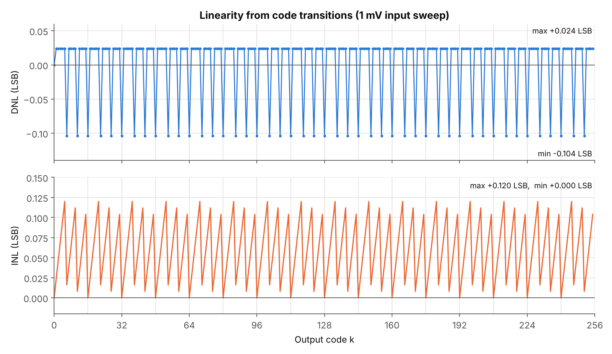

# Static Linearity: DNL, INL and Missing Codes

[← README](../README.md)

## Definitions used

- **Transition voltage `T_k`:** the lowest swept input at which the output reaches code k.
- **DNL:** how far each step between transitions differs from 1 LSB: `DNL_k = (T_k − T_(k−1))/LSB − 1`. A code that is too narrow gives negative DNL, a code that is too wide gives positive DNL, and a missing code gives −1.
- **INL:** the accumulated DNL, which equals the offset of each transition from its ideal position: `INL_k = (T_k − k·LSB)/LSB`.
- **Ideal LSB:** `Vref / 2^8 = 7.8125 mV`.

Implementation details and indexing conventions are in [mathematical-model.md §4](mathematical-model.md#4-linearity-extraction).

## Results with the report's 1 mV sweep



Values from running [`run_linearity_analysis.m`](../matlab/run_linearity_analysis.m) in GNU Octave 8.4.0 ([`results/summary.txt`](../results/summary.txt), [`results/linearity/linearity.csv`](../results/linearity/linearity.csv)):

| Metric | Model run | Report |
|---|---:|---:|
| DNL minimum | −0.104 LSB (47 codes) | ≈ −0.10 LSB |
| DNL maximum | +0.024 LSB (208 codes) | ≈ +0.02 LSB |
| max \|DNL\| | 0.104 LSB | ≈ 0.10 LSB |
| INL minimum | 0.000 LSB (codes 0, 16, …, 240) | ≈ 0 ("slightly negative, very small") |
| INL maximum | +0.120 LSB (codes 5, 21, …, 245) | ≈ +0.12 LSB |
| max \|INL\| | 0.120 LSB | ≈ 0.12 LSB |
| Measured step widths | only 7 mV and 8 mV | — |

The report's figure shows the same picture: DNL alternates between two levels, and INL is a sawtooth with three teeth every 16 codes.

The run gives an INL minimum of exactly 0. The report's "slightly negative" may come from floating-point round-off in MATLAB's `cumsum` (about 1e-15). This could not be confirmed without MATLAB, and it does not matter at the precision reported.

## What causes the nonzero DNL/INL

The converter is ideal, so its real transitions are exactly at `k × 7.8125 mV`. A 1 mV sweep can only see the first grid point at or above each one:

```
T_k(measured) = ⌈k × 7.8125⌉ mV
k = 1 : 7.8125 → 8 mV   INL = 0.024
k = 5 : 39.0625 → 40 mV INL = 0.120   (maximum)
k = 6 : 46.875 → 47 mV  INL = 0.016   (step 7 mV → DNL = −0.104)
k = 16: 125 → 125 mV    INL = 0       (grid and LSB line up again)
```

The [sweep-step study](../matlab/sweep_step_study.m) isolates the effect by changing only the sweep step:


| Sweep step | DNL min | DNL max | INL max | Missing codes |
|---|---:|---:|---:|---:|
| 1 mV (report) | −0.104 | +0.024 | 0.120 | 0 |
| 0.5 mV | −0.040 | +0.024 | 0.056 | 0 |
| 0.1 mV | −0.0016 | +0.0112 | 0.0112 | 0 |
| 0.01 mV | −0.00032 | +0.00096 | 0.00096 | 0 |
| LSB/8 | 0 | 0 | 0 | 0 |
| LSB/64 | 0 | 0 | 0 | 0 |

Source: [`results/sweep-study/sweep_step_study.csv`](../results/sweep-study/sweep_step_study.csv).

**Conclusions**

1. The reported DNL/INL values are **upper bounds set by the testbench** (sweep resolution ≈ 0.128 LSB). They do not describe converter nonlinearity.
2. The ideal two-step model has **zero DNL and INL**. Its codes are identical to a direct 8-bit `floor` quantizer (all 2001 swept points match).
3. The pattern repeats every 16 codes because `16 × LSB = 125 mV` is a whole number of millivolts. That this period equals the coarse-stage step is a coincidence of the numbers.
4. The report explains the repeating pattern as capacitor mismatch, comparator imbalance and residue gain error. That explanation is **not supported**, because the model contains none of those effects. They are real mechanisms in hardware, and modeling them is listed under [future work](../README.md#future-work).

## Missing codes and monotonicity

Checked directly on the model output, not inferred from DNL:

| Check | Method | Result |
|---|---|---|
| All codes present | `setdiff(0:255, unique(D_out))` | empty → **no missing codes** |
| Monotonic | `all(diff(D_out) >= 0)` | true on the 1 mV sweep |
| DNL margin | min DNL vs −1 LSB | −0.104 ≫ −1 |

The report says there are no missing codes "since the difference in steps is less than 1 unit". The correct criterion is DNL > −1 LSB for every code, and that criterion is met here. This repository verifies monotonicity only on the swept grid. It does not claim monotonicity for inputs between grid points, although the ideal equations make it true by construction.

## How real nonidealities would appear (not modeled)

| Nonideality | Expected DNL/INL signature |
|---|---|
| Residue gain < 16 | top fine codes never reached in each coarse region → missing codes (DNL = −1) every 16 codes |
| Residue gain > 16 | fine stage saturates early → wide last code in each region (large positive DNL) every 16 codes |
| DAC level error | step in the transfer curve at coarse boundaries → DNL spike every 16 codes; INL shape follows the DAC's INL |
| Coarse comparator offset | residue leaves the fine range → missing or wide codes near coarse boundaries (unless stages overlap) |
| Fine comparator offset | the same DNL pattern repeats inside every coarse region |

These are standard expectations for the architecture, not results from this repository.

Next: [results.md](results.md)
